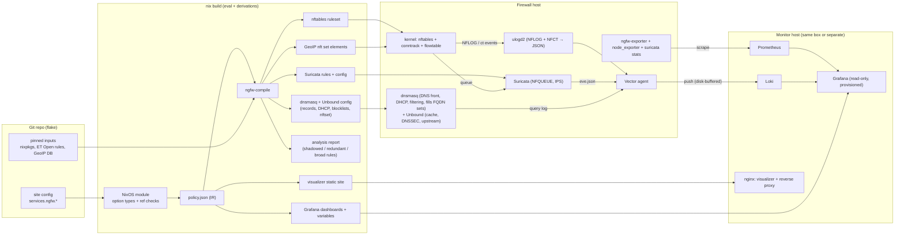
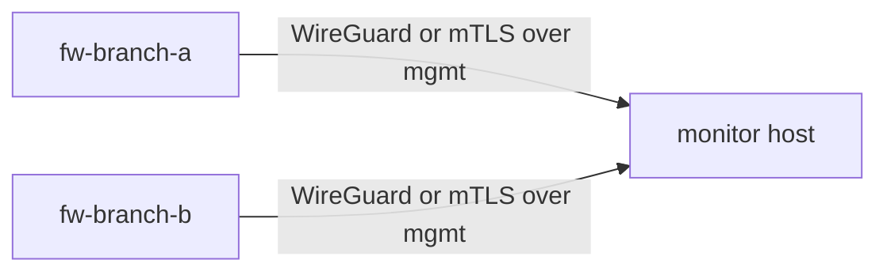

# 01 — Architecture

## 1. Component overview



## 2. Components

| Component | Role | Source | Custom? |
|-----------|------|--------|---------|
| NixOS module `services.ngfw` | Option types, cross-reference validation, IR emission, wiring of all services | this repo | yes |
| `ngfw-compile` | IR → nftables, Suricata rules, dnsmasq/Unbound config, compiled blocklists, Geo sets, analysis report | this repo (Rust) | yes |
| `ngfw-eval` (lib) | Packet/flow → verdict evaluator over IR; shared by compiler tests and visualizer (WASM) | this repo (Rust) | yes |
| nftables | Stateful filtering, NAT, sets, flowtable offload, logging | nixpkgs | no |
| Suricata | IDS/IPS, application-layer protocol detection, TLS SNI/JA3/JA4 | nixpkgs | no |
| dnsmasq | Client-facing DNS (local records, filtering, query log), DHCPv4/v6 + RA with name registration; populates nft sets for FQDN objects (11) | nixpkgs | no |
| Unbound | Loopback-only backend: cache, DNSSEC validation, recursion or DNS-over-TLS forwarding (11) | nixpkgs | no |
| ulogd2 | Collects NFLOG (per-packet decision logs) and NFCT (flow start/end with counters), emits JSON | nixpkgs | no |
| `ngfw-exporter` | Prometheus exporter: per-rule counters, set sizes, conntrack, queue stats, policy info | this repo | yes |
| node_exporter | Host/interface metrics | nixpkgs | no |
| Vector | Log shipping, parsing, normalization (§04), enrichment (GeoIP, rule metadata) | nixpkgs | no |
| Prometheus | Metrics TSDB | nixpkgs | no |
| Loki | Log store | nixpkgs | no |
| Grafana | Dashboards, alerting; fully provisioned, UI edits disabled | nixpkgs | no |
| nginx | Serves visualizer; TLS termination and auth front for Grafana + visualizer | nixpkgs | no |
| Visualizer | Static SPA: rules table, flow graph, path tracer | this repo (TS + WASM) | yes |

## 3. Topologies

Selected with `services.ngfw.monitoring.mode`:

### 3.1 `local` (default)

All components on the firewall. Grafana, Loki, Prometheus and nginx bind **only** to
addresses on interfaces in a zone flagged `management = true`.

- ARCH-001 [P0] In `local` mode the module MUST configure Prometheus, Loki, Grafana, nginx and
  the visualizer with no further user input other than credentials.
- ARCH-002 [P0] Resource caps (systemd `MemoryMax`, `CPUQuota`) MUST be applied to the
  monitoring services so that telemetry cannot starve the data plane. Defaults documented
  in 07 §7.

### 3.2 `remote`

Firewall runs only the collection side (exporters, ulogd2, Vector). A second NixOS host
imports `nixosModules.ngfw-monitor`.



- ARCH-010 [P0] Metrics: the monitor host scrapes the firewall's exporters (pull). Logs:
  Vector on the firewall pushes to Loki (push) with an on-disk buffer.
- ARCH-011 [P0] The monitor module MUST take a list of firewall NixOS configurations
  (`services.ngfw-monitor.firewalls = [ self.nixosConfigurations.fw-a ... ]`) and derive
  scrape targets, Loki tenants/labels and visualizer data from each firewall's IR. No firewall
  details are re-typed on the monitor side.
- ARCH-012 [P0] All telemetry traffic MUST be encrypted and authenticated (WireGuard tunnel
  managed by the module, or mTLS; see OPEN-6).
- ARCH-013 [P0] Monitor unreachability MUST NOT affect forwarding. Vector buffers to disk up
  to a configurable cap (default 2 GiB), then drops oldest **allow** logs before **deny/IPS**
  logs (priority buffering, see 04 §5).
- ARCH-014 [P1] One monitor host MAY serve N firewalls; every metric and log carries a
  `firewall` label; the visualizer has a firewall selector.

## 4. Build pipeline and the IR

1. Module evaluation: Nix option types validate shape; module code validates references
   (zones, objects, services, apps exist), uniqueness, and simple invariants (02 §9).
2. The module serializes the resolved policy to `policy.json` (schema: 02 §10). This is a
   derivation output and is exposed as `config.services.ngfw.build.ir`.
3. `ngfw-compile` runs in a derivation over the IR + pinned feeds and produces:
   `ruleset.nft`, `suricata/ngfw.rules`, `suricata/ngfw.yaml` fragment, `dnsmasq.conf` (records, DHCP, blocklist, nftset), `unbound.conf`,
   `geo/*.nft`, `rule-map.json` (rule ID ↔ numeric tag ↔ Suricata SID range), `analysis.json`.
4. `ruleset.nft` is checked with `nft -c` inside the build sandbox (reuse
   `networking.nftables.checkRuleset`).
5. The visualizer derivation bundles the SPA + `policy.json` + `rule-map.json` + `analysis.json`.

- ARCH-020 [P0] The IR MUST be deterministic: same inputs ⇒ byte-identical `policy.json`.
  `policy_hash` = SHA-256 of the canonical IR and is exported as a metric label
  (`ngfw_policy_info{policy_hash, generation}`) and stamped on every log line.
- ARCH-021 [P0] `ngfw-compile` MUST be the only producer of data-plane artifacts. The NixOS
  module MUST NOT emit nftables rules by string concatenation in Nix (except bootstrap tables
  in 03 §2 that are policy-independent).

- ARCH-022 [P0] `ngfw-ir`, `ngfw-eval`, `ngfw-compile` and `ngfw-exporter` are written in Rust
  (D-6). `ngfw-eval` MUST build for both the host target and `wasm32-unknown-unknown` from the
  same source, with no target-specific matching logic.

## 5. Repository layout (target)

```
flake.nix
nix/
  modules/
    ngfw/            # services.ngfw.* — options, IR emission, service wiring
    ngfw-monitor/    # services.ngfw-monitor.* — Prometheus, Loki, Grafana, nginx, visualizer
  lib/               # helpers exposed as flake lib (object constructors, service catalog)
  catalogs/
    services.nix     # built-in service definitions (ssh, https, dns, ...)
    apps.nix         # built-in App-ID catalog (02 §5)
crates/
  ngfw-ir/           # IR types + JSON schema generation
  ngfw-eval/         # evaluator (native + wasm32)
  ngfw-compile/      # IR → artifacts, analysis
  ngfw-exporter/     # Prometheus exporter
visualizer/          # TS SPA (built with buildNpmPackage)
dashboards/          # Grafana dashboard sources (Jsonnet/Grafonnet or JSON) → see 05 §1
tests/
  vm/                # NixOS VM tests (09)
  conformance/       # evaluator vs kernel property tests
examples/
  branch-office/     # full reference site config
docs/specs/
```

Flake outputs: `nixosModules.{ngfw,ngfw-monitor}`, `packages.<sys>.{ngfw-compile,ngfw-exporter,visualizer}`,
`lib`, `checks.<sys>.*` (all of 09), `templates.default` (new-site skeleton), `apps.<sys>.{deploy,confirm,policy-diff}`.
