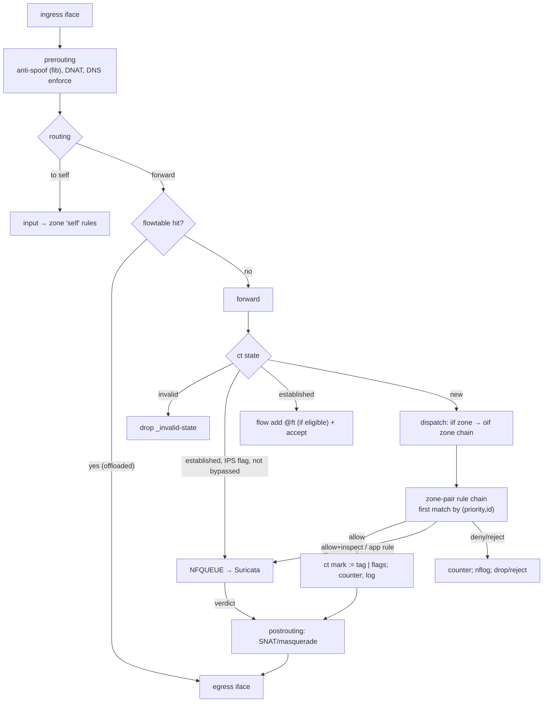

# 03 — Data plane

## 1. Packet path

## 2. nftables layout

- DP-001 [P0] All policy lives in one table `table inet ngfw`, replaced atomically
  (`nft -f` of a file starting with `flush table inet ngfw` / `destroy table`). Other tables
  (e.g. ones NixOS creates for containers) are left untouched; `networking.firewall` (the stock
  NixOS firewall) MUST be disabled by the module, with an assertion if the user re-enables it.
- DP-002 [P0] Chains: `prerouting` (dstnat, antispoof), `input`, `forward`, `output`,
  `postrouting` (srcnat), plus generated `zp_<from>_<to>` chains per zone pair that has rules,
  dispatched with `iifname vmap` → `oifname vmap` (O(1) per packet regardless of zone count).
- DP-003 [P0] Every user and system rule compiles to exactly one nft *rule group* that ends in a
  named counter `counter name "r_<id>"` so per-rule hits are readable via `nft -j list counters`.
- DP-004 [P0] Objects compile to named sets (`set o_<name>_v4`, `_v6`) with `flags interval;
  auto-merge` where applicable, so rule text stays small and set membership is visible.
- DP-005 [P0] Anti-spoofing: `fib saddr . iif oif missing drop` in prerouting (counted as
  `_antispoof`), configurable per zone (`zones.<z>.antiSpoof = true` default, `false` for
  asymmetric-routing zones).
- DP-006 [P0] Policy-independent bootstrap (loopback, ICMPv6 essentials, the table skeleton)
  MAY be hand-written in the module; everything else comes from `ngfw-compile` (ARCH-021).

## 3. Marks

Conntrack mark (`ct mark`, 32 bit) carries the decision for the flow's lifetime:

| Bits | Meaning |
|------|---------|
| 0–23 | Rule tag (numeric ID of the deciding rule) |
| 24 | `INSPECT` — flow is sent to Suricata |
| 25 | `BYPASSED` — Suricata released the flow; eligible for offload |
| 26 | `LOG_FLOW` — emit flow start/end records |
| 27 | `APP_PENDING` — verdict depends on app detection |
| 28–31 | reserved |

Packet mark (`meta mark`) bits 0–1 are reserved for Suricata NFQ `repeat-mark` / `bypass-mark`.

- DP-010 [P0] Rule tags are derived as a 24-bit truncated hash of the rule ID; collisions fail the
  build (VAL-07) and are resolved by setting `rules.<id>.tag` explicitly. Hash-derived tags keep
  logs attributable across generations (tags don't shift when rules are added).
- DP-011 [P0] The mark masks MUST be configurable (`dataplane.markMask`) for coexistence with
  other mark users; the compiler only touches bits within the mask.
- DP-012 [P1] Policy-change conntrack flush: after a switch, flows whose tag belongs to a rule that
  was removed or narrowed (`analysis.json` diff vs previous generation) are deleted with
  `conntrack -D --mark <tag>/<mask>`. Option `dataplane.onPolicyChange = "keep" | "flushAffected"`
  (default `flushAffected`). Without this, removing an allow rule leaves existing sessions up.

## 4. State, offload and performance

- DP-020 [P0] `nf_conntrack_acct = 1`; conntrack table size and hash size configurable
  (default: 524 288 entries, ~160 MB kernel memory, sized for the 8 GB reference); timeouts
  configurable per protocol.
- DP-021 [P0] A software flowtable `ft` (with `counter`) covers all zone interfaces. Flows are
  offloaded when established **and** (not `INSPECT` **or** `BYPASSED`). Hardware offload
  (`flags offload`) is opt-in per NIC.
- DP-022 [P0] Because offloaded packets skip rule chains, the per-rule `counter` counts *flows*
  (first packets), while per-rule byte/packet volume comes from conntrack accounting via
  flow-end logs (04 §3). Dashboards MUST label these accordingly.
- DP-023 [P1] Per-rule rate limits (`rules.<id>.limit = { rate = "100/second"; burst = 200; perSource = true; }`)
  via `limit` / meters.
- DP-024 [P1] SYN-flood protection via `synproxy` for published services (`rules.<id>.synproxy = true`).

Performance targets on the reference hardware (D-9: x86-64, 4 cores, 8 GB; NIC TBD).
Core layout: cores 0–1 kernel networking (softirq) + telemetry, cores 2–3 Suricata workers.

| ID | Metric | Target |
|----|--------|--------|
| PERF-1 | L3/L4 forwarding, 1500B, software flowtable offload | ≥ 9 Gbps on 10 GbE (≥ 2.35 Gbps on 2.5 GbE) |
| PERF-2 | New connections/s, non-inspected | ≥ 20 000 cps |
| PERF-3 | Concurrent flows | ≥ 500 000 |
| PERF-4 | IPS-inspected throughput (ET Open, 2 worker cores, IMIX) | ≥ 750 Mbps |
| PERF-5 | Ruleset apply time for 2 000 rules / 200 objects | < 2 s, zero established-flow loss |
| PERF-6 | Telemetry overhead (local mode) at PERF-2 load, `log = "sampled"` | < 20% of CPU |

- DP-025 [P0] The build MUST emit a warning (error in `strict`) when the configuration is
  unlikely to fit the reference budget: local monitoring mode with `log = "flow"` on rules whose
  combined `expectedFlowsPerSecond` exceeds 500, or Suricata memory settings exceeding the
  service's `MemoryMax` (07 §7).

## 5. IPS / IDS (Suricata)

- DP-030 [P0] Suricata runs in NFQ mode with `mode: repeat` (repeat-mark/bypass-mark per §3),
  `fail-open: no`, and the nft `queue` statement uses `flags fanout` over `ips.queues` (default:
  one per Suricata worker, `num 0-<n-1>`) **without** `bypass` (D-10, fail-closed).
- DP-036a [P0] Fail-closed scope: only packets of flows selected for inspection are dropped while
  Suricata is unavailable or its queues overflow; all other traffic keeps flowing. Drops are
  counted (`ngfw_nfqueue_dropped_total{reason="no_listener"|"overflow"}`) and raise
  `NGFWIPSDown` / `NGFWQueueDrops`.
- DP-036b [P1] `ips.failOpen = true` MAY be offered as an explicit per-site override with a
  build warning; it is not the default.
- DP-031 [P0] Only flows matching rules with `inspect = "ips"` or app conditions are queued.
  Non-inspected traffic never touches Suricata.
- DP-032 [P0] Signature sources: ET Open from the pinned feed mirror commit (D-12, 07 §5), plus `ips.extraRules`
  (inline text or paths in the repo). `suricata-update` runs **at build time** in a derivation,
  never on the box (unless runtime refresh is enabled, 07 §5).
- DP-033 [P0] Signature action policy is declarative: `ips.mode = "detect" | "prevent"`;
  in prevent mode, `ips.dropPolicy` selects which signatures become `drop`
  (by classtype, severity, SID list, or ET category), everything else alerts.
  `ips.disable` / `ips.enableOnly` lists for SIDs and categories.
- DP-034 [P0] Encrypted flows are bypassed after handshake (`encryption-handling: bypass`)
  once app-ID has a verdict, enabling offload (DP-021).
- DP-035 [P0] Rule reloads use `suricatasc -c reload-rules` (no restart, no queue gap) when only
  rules changed. Because the IPS fails closed, a Suricata **restart** interrupts inspected
  traffic: the module MUST prefer live reload, and `deploy` MUST print a warning listing the
  inspected rules affected when a change requires a restart.
- DP-036 [P1] Per-rule `inspect = "ids"` (alert-only for that rule's traffic even in prevent
  mode). Mechanism TBD: Suricata cannot see nft marks, so this needs either a second
  Suricata instance on a separate queue range, or compiler-generated address/port predicates
  scoping drop rules. OPEN-7.

## 6. Application identification

The hard part: rules are first-match by priority, but an app condition is only known after
several packets, and only Suricata knows it.

**Semantics** (normative, implemented by `ngfw-eval`): the verdict is a function
`verdict(flow5tuple, zones, app)` = action of the first rule in `(priority, id)` order whose
L3/L4 predicate matches **and** whose app predicate (if any) contains `app`. `app` may be
`unknown` (not detected within `appId.detectionTimeout`, default 10 packets in each direction
or 4 KiB).

**Realization:**

1. In nft, for a new flow, let *R* be the first rule whose L3/L4 predicate matches.
   - If *R* has no app predicate → final verdict in nft.
   - If *R* has an app predicate → nft sets `ct mark = tag(R) | INSPECT | APP_PENDING` and queues.
2. For every such *decision point R*, the compiler computes the ordered candidate list:
   R and all later rules (in the same zone pair or `any`) whose L3/L4 predicate overlaps R's,
   up to and including the first one without an app predicate (the *fallback*), or
   `_default-deny`.
3. The compiler emits Suricata rules for each candidate whose predicates are **pairwise disjoint**
   (each candidate's L3/L4 ∩ app region minus all earlier candidates' regions), so Suricata's
   fixed action ordering (`pass` > `drop` > …) cannot change the outcome.
   - DP-040 [P0] Allowed outcomes emit `pass` (then bypass for offload); denied outcomes emit
     `drop` (or `reject`). Each generated Suricata rule has a SID in the rule's `sid_range`
     and `metadata: ngfw_rule <id>` so eve.json events attribute to the deciding rule.
   - DP-041 [P0] The `unknown`-app outcome is a generated rule on `flow` timeout /
     `app-layer-protocol:failed` per candidate's `onUnknownApp`.
4. Until detection, packets of APP_PENDING flows are accepted (POL-031).

- DP-042 [P0] The app catalog maps each app to Suricata predicates (app-layer protocol,
  `tls.sni`, `quic.sni`, `http.host`, `ja3.hash`/`ja4.hash`, `dns.query`). Catalog entries
  are data in `nix/catalogs/apps.nix`, extendable by users.
- DP-043 [P0] Conformance (09 §3) MUST demonstrate nft+Suricata produce the `ngfw-eval` verdict
  for generated (flow, app) samples, including overlapping and fallback cases.
- DP-044 [P0] This mechanism is the highest-risk item; milestone M3 begins with a design spike
  that confirms the Suricata keyword support and the disjoint-rule compilation on the pinned
  Suricata version. If infeasible, fallback semantics for v1: app rules may only be `deny`
  overlays on flows already allowed by an L3/L4 rule (documented as a breaking restriction).

## 7. FQDN rules

- DP-050 [P0] dnsmasq (the client-facing resolver, 11 §1) inserts resolved A/AAAA records into
  `fq_<name>_v4/_v6` sets via `nftset=` **before** returning the answer, so a client's first
  connection after resolving already matches (T-23).
- DP-051 [P0] FQDN sets are declared with `flags timeout; timeout <fqdn.setTimeout>` (default
  1 h, refreshed on each resolution). Elements are never persisted across reboots; boot
  starts with empty sets (fail-closed for allows, fail-open for denies — documented).
- DP-052 [P0] Entry semantics: `example.com` matches the domain **and all subdomains**
  (dnsmasq semantics). This MUST be stated in docs and the visualizer. (Updates 02 §3:
  the `*.` prefix is accepted as an alias.)
- DP-053 [P0] DNS enforcement option `dns.enforce = true` (default when any FQDN object exists or
  DNS filtering is enabled): generates `_dns-redirect` (DNAT tcp/udp 53 from enforced zones to self),
  `_dot-block` (tcp/853), and `_doh-block` (deny of app `doh`, catalog of known DoH SNIs).
- DP-054 [P0] Known limitation (documented, surfaced in visualizer tooltips): IPs shared by
  many domains (CDNs) make FQDN allows over-permissive; for strict cases use App-ID with SNI.
- DP-055 *Withdrawn* — superseded by DNS-040 (DNS query logs are P0).

Resolver architecture (dnsmasq front + Unbound backend) is specified in 11 §1, which replaces
OPEN-9.

## 8. GeoIP rules

- DP-060 [P0] Source DB: DB-IP Lite Country (CC BY 4.0, no license key) from the pinned feed
  mirror commit (D-12)
  (fixed-output derivation with hash). MaxMind GeoLite2 supported as an alternative input when
  the user supplies it.
- DP-061 [P0] `ngfw-compile` extracts CIDRs **only for referenced countries** and emits interval
  sets `geo_<CC>_v4/_v6`. Attribution notice ships in the visualizer footer.
- DP-062 [P0] The IR records the DB version/date; the exporter exposes
  `ngfw_feed_age_seconds{feed="geoip"}`; an alert fires above 60 days.
- DP-063 [P1] Runtime refresh (07 §5) updates only set elements via `nft -f` of a set-flush+add
  file, never the ruleset.

## 9. Logging hooks

- DP-070 [P0] Deny/reject rules with `log != "none"`: `log group <N> prefix "<tag-hex>"` with a
  per-rule `limit rate` (default 50/s, burst 100) so log floods cannot become a DoS.
- DP-071 [P0] Allow rules with `log = "flow"` set `LOG_FLOW`; ulogd2's NFCT input with a
  ct-mark filter emits NEW and DESTROY events (DESTROY carries bytes/packets both directions).
- DP-072 [P0] `log = "sampled"`: flow logging for 1 in `sampleRate` new flows (nft `numgen random`).
- DP-073 [P0] Logging MUST never block forwarding: NFLOG group queue thresholds set, ulogd2
  overflow counted and exported (`ngfw_log_dropped_total`).
