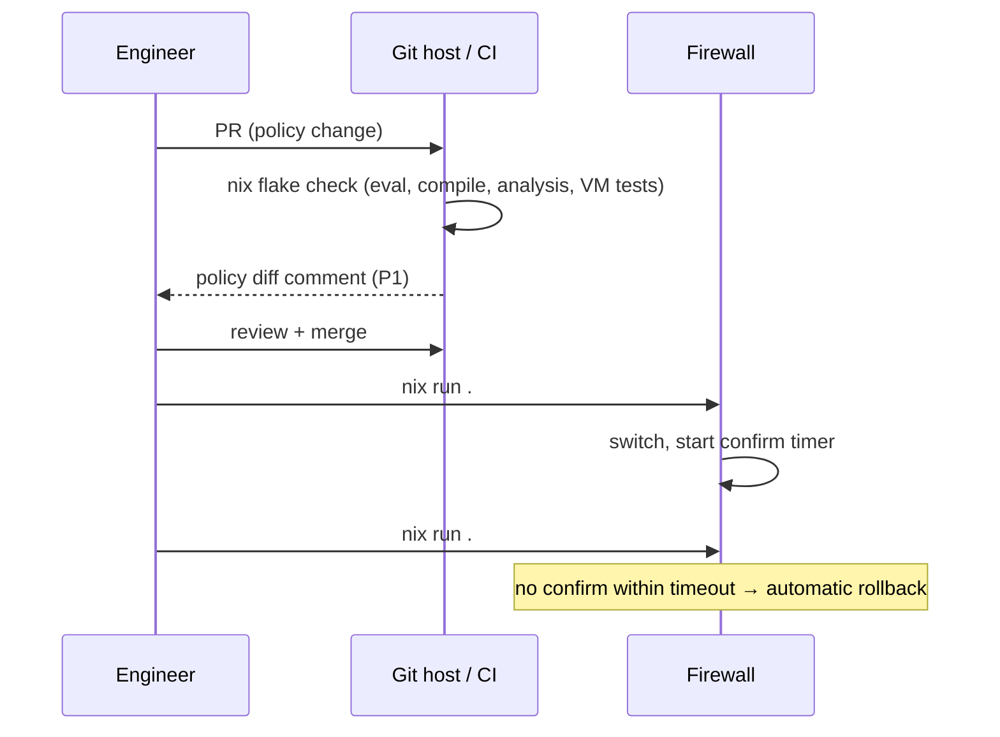
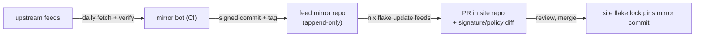

# 07 — Operations

## 1. Change workflow



- OPS-001 [P0] `nix flake check` MUST run all evaluation checks, compiler analysis, `nft -c`,
  dashboard compilation, visualizer build and the fast VM test subset (09).
- OPS-002 [P0] Production mode (`services.ngfw.production = true`) refuses to build from a dirty
  tree (`self.rev` absent) and implies `strict = true`.

## 2. Deployment

- OPS-010 [P0] `apps.deploy` wraps `nixos-rebuild switch --target-host` (or is compatible with
  deploy-rs/colmena) and always uses commit-confirm (§3).
- OPS-011 [P0] Data-plane apply order on switch: (1) GeoIP/FQDN/object sets, (2) nft ruleset
  (atomic), (3) Suricata rule reload or restart, (4) dnsmasq + Unbound reload (leases and FQDN sets preserved, DNS-003), (5) telemetry services.
  A failure in 1–2 aborts the switch with the previous ruleset still loaded.
- OPS-012 [P0] Each activation emits a `stream="change"` event (generation, policy_hash, git rev,
  actor from `SUDO_USER`/deploy tool, result) for Grafana annotations.
- OPS-013 [P0] The ruleset is loaded before any zone interface is brought up at boot
  (`nftables.service` before `network-pre.target`); interfaces are never up without policy.

## 3. Commit-confirm and rollback

- OPS-020 [P0] After a switch triggered by `deploy`, `ngfw-confirm.timer` (default 120 s,
  `operations.confirmTimeout`) starts. If `ngfw-confirm` is not invoked in time, the host
  activates the previous system generation and emits `NGFWRolledBack`.
- OPS-021 [P0] `nix run .#confirm -- <host>` connects **over the management zone using a new
  connection** (proves management reachability with the new policy, not via the existing SSH
  session that survives due to conntrack).
- OPS-022 [P0] Rollback restores the full system generation (ruleset, Suricata, dashboards —
  everything), not only nft.
- OPS-023 [P0] `ngfw-rollback` CLI for console use: lists generations with policy_hash and git
  rev and switches to a chosen one.
- OPS-024 [P0] Local `nixos-rebuild switch` on the box (without `deploy`) also arms the
  confirm timer unless `--no-confirm` is passed via `NGFW_NO_CONFIRM=1`.

## 4. Upgrades

- OPS-030 [P0] nixpkgs and inputs are bumped via PRs; VM tests gate merges. Release notes list
  any IR/log schema changes.
- OPS-031 [P0] IR major version changes ship with a migration note; the visualizer/exporter
  refuse unknown majors (POL-082).

## 5. Feeds

External feeds are delivered through a **feed mirror repository** (D-12): a separate Git repo
that holds every fetched feed version as plain files and never rewrites history. Site flakes pin
a commit of it, so every site commit stays rebuildable even after upstream has overwritten or
removed the original download.

| Feed | Upstream | Mirror cadence | Site update path |
|------|----------|----------------|------------------|
| ET Open signatures | `rules.emergingthreats.net` (fixed URL, overwritten daily) | daily | bot PR bumping `inputs.feeds` |
| GeoIP (DB-IP Lite Country) | `download.db-ip.com` (monthly file) | monthly | same PR flow |
| App catalog | this repo | with releases | — |



### 5.1 Mirror repository

- OPS-040 [P0] Layout (one commit may update several feeds):
  ```
  et-open/suricata-<major.minor>/rules/*.rules     # unpacked, text → small Git deltas
  et-open/suricata-<major.minor>/META.json
  geoip/dbip-country-lite/<YYYY-MM>/dbip-country-lite.csv
  geoip/dbip-country-lite/<YYYY-MM>/dbip-country-lite.mmdb   # for Vector enrichment
  geoip/dbip-country-lite/<YYYY-MM>/META.json
  LICENSES/                                        # upstream license + attribution texts
  ```
  `META.json` records: upstream URL, fetch timestamp (UTC), upstream checksum and how it was
  verified, file count, rule count / prefix count, mirror bot version.
- OPS-041 [P0] **Append-only**: the default branch and all tags are protected; force-push and
  history rewrites are forbidden; nothing is ever deleted. GeoIP keeps every month as its own
  directory (old months are still needed by old site commits); ET Open is overwritten in place
  per commit (history holds old versions).
- OPS-042 [P0] Site flakes consume it as `inputs.feeds = { url = "git+https://…/ngfw-feeds?shallow=1"; flake = false; }`
  (shallow fetch: building a site never downloads the full history). The compiler reads
  `et-open/suricata-<ver>` matching the Suricata version in the pinned nixpkgs, and fails the
  build with a clear message if that version directory is missing.
- OPS-043 [P0] Each mirror commit is tagged `et-open/<YYYY-MM-DD>` and/or `geoip/<YYYY-MM>` and
  signed by the bot's key. [P1] Site builds verify the pinned commit's signature against
  `feeds.trustedSigners`.
- OPS-044 [P0] Ownership: the mirror is self-hostable (any Git host), so air-gapped and
  privacy-sensitive sites can run their own. Whether the project also publishes a shared public
  mirror depends on the upstream redistribution terms (see OPEN-14); the spec does not
  assume one.

### 5.2 Mirror bot

- OPS-045 [P0] Runs as a scheduled CI job (reference: a GitHub/Forgejo Actions workflow in the
  mirror repo, implemented as `nix run .#feed-mirror` so it is reproducible and testable). Steps:
  1. Fetch each feed; verify the upstream checksum where one is published (ET Open `.md5`);
     reject responses that are truncated or not the expected format.
  2. Validate: ET Open parses with `suricata -T` using the pinned Suricata version for every
     mirrored `<major.minor>`; GeoIP CSV parses and the mmdb opens; the CSV and mmdb agree on
     a sample of prefixes.
  3. Sanity limits: fail (no commit, alert the maintainers) if the rule count or prefix count
     changes by more than ±20% compared with the previous version, unless a maintainer approves
     by hand.
  4. Commit only when the content changed; tag; push.
- OPS-046 [P0] A second job in each **site** repo runs after mirror updates: `nix flake update feeds`,
  then opens a PR containing a signature diff (SIDs added / removed / modified, and changes to
  which SIDs become `drop` under `ips.dropPolicy`) and a GeoIP diff (prefix churn for
  referenced countries). Merging and deploying stays a human decision; auto-merge MAY be
  enabled per site for feed-only PRs that pass all checks.
- OPS-047 [P0] Upstream outages: the bot makes no commit, and the site's `NGFWFeedStale` alert
  (05 §4) fires once the pinned feed passes its age threshold. No fallback source is used
  automatically.
- OPS-048 [P0] Growth budget: unpacked ET Open text changes produce small daily deltas; GeoIP
  adds ~10–15 MB per month (CSV + mmdb). Expected total growth is well under 1 GB per year; the
  bot reports repository size as a metric. Git LFS is **not** used (LFS objects can be pruned
  by hosts, which would break OPS-041).

### 5.3 Runtime refresh (opt-in)
- OPS-049 [P1] Opt-in runtime refresh (`feeds.<name>.runtimeRefresh = { enable; interval; }`):
  a hardened systemd service fetches, validates (signature/checksum, size, parse), and applies
  **only** signature or set-element updates. Status exported as `ngfw_feed_info{source="runtime"}`.
  This explicitly trades reproducibility (G-3) for freshness and is off by default.

## 6. Secrets

- OPS-050 [P0] Secrets are never in the Nix store. Supported backends: sops-nix (default) and
  agenix. Secrets: Grafana admin password, user password hashes or OIDC client secret, TLS key,
  WireGuard telemetry keys, contact-point credentials, optional MaxMind license key.

## 7. Resource defaults (local mode, reference: 4 cores / 8 GB, D-9)

| Service | CPU | Memory (`MemoryMax`) |
|---------|-----|--------|
| Kernel (conntrack 512k, sets, buffers) | cores 0–1 softirq | ~0.5 GB |
| OS, sshd, ulogd2, exporters | cores 0–1 | ~0.4 GB |
| dnsmasq (500k-domain blocklist) + Unbound (64 MB cache) | cores 0–1 | ~0.4 GB |
| Suricata | pinned to `ips.cpus` (default cores 2–3) | 2.5 GB |
| Prometheus | 25% of one core | 768 MB |
| Loki | 50% of one core | 1.25 GB |
| Grafana | 25% | 384 MB |
| Vector | 50% | 384 MB |
| nginx, oauth2-proxy | — | 128 MB |
| **Headroom** (page cache, spikes) | | ~1.2 GB |

- OPS-070 [P0] Suricata runs with a reduced-memory detect profile (`detect.profile: medium`,
  bounded `stream.memcap`/`flow.memcap`) that fits 2.5 GB with full ET Open; the build fails if
  configured memcaps exceed `MemoryMax`.
- OPS-071 [P0] On the reference hardware `remote` monitoring mode is the recommended production
  setup; `local` mode is supported with the reduced retention in 04 §6.

NIC IRQ affinity and RSS: `dataplane.irqAffinity` [P1] sets IRQs to cores not used by Suricata.

## 8. High availability

Out of scope for now (D-15, NG-8). OPS-060, OPS-061 and OPS-062 are *Withdrawn*.
