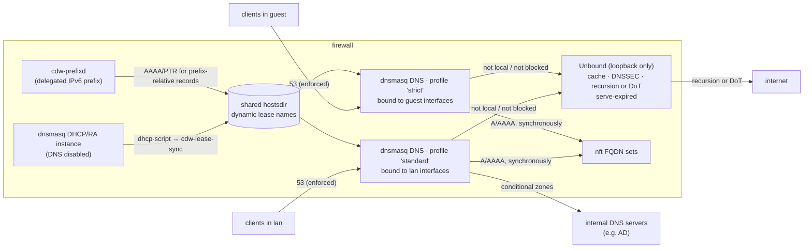

# 11 — DNS & DHCP services

The firewall is the site's DNS server and DHCP server: it answers for local names declared in
Nix, caches and validates everything else, filters malicious or unwanted domains, hands out
addresses, and registers DHCP clients' names in DNS.

## 1. Architecture



Why dnsmasq in front of Unbound (D-14, supersedes OPEN-9):

| Need | dnsmasq | Unbound |
|------|---------|---------|
| Add resolved IPs to nft sets **before** the answer reaches the client | ✅ native `nftset=` | ❌ only asynchronously (dnstap), which races the client's first connection |
| DHCP with automatic name registration | ✅ native | ❌ |
| Per-client query/block logging | ✅ | — (would only see dnsmasq as the client) |
| DNSSEC validation, large cache, DNS-over-TLS upstream, full recursion, serving stale answers during WAN outages | weak / ❌ | ✅ |

So dnsmasq is the client-facing front and Unbound is a loopback-only backend. Filtering happens
in dnsmasq, so block events keep the real client IP. dnsmasq has no per-client "views", so
per-zone filtering (D-16) is done with one dnsmasq DNS instance per filter profile, each bound
only to the interfaces of its zones (§2.4). DHCP runs in its own instance.

- DNS-001 [P0] dnsmasq DNS instances listen only on addresses of zones with `dns.serve = true` (default: every
  zone except those containing the default route). The module asserts that no DNS listener is
  bound to a WAN-zone address (no open resolver).
- DNS-002 [P0] Unbound listens on `127.0.0.1:5353` / `[::1]:5353` only, and dnsmasq is its sole
  client. The firewall itself resolves through dnsmasq (`networking.nameservers = [ "127.0.0.1" ]`).
- DNS-003 [P0] All dnsmasq and Unbound configuration is generated by `cdw-compile` from the IR
  (ARCH-021). Static configuration changes reload the daemons; dnsmasq restarts preserve the DHCP
  lease database and do not empty the kernel FQDN sets.

Alternative considered and rejected (OPEN-15 → D-14): Unbound as the only resolver, with a custom
synchronous set-update module, plus Kea for DHCP. It has native per-client views, but needs
custom C/Rust resolver-module code in the packet-critical path. Per-zone filtering being
mandatory makes that alternative more attractive than before, but multi-instance dnsmasq covers
it with stock components; revisit only if the M2 spike (DNS-037) fails.

## 2. Configuration surface

```nix
services.cdw.dns = {
  localDomain = "branch-a.corp.example.com";   # warns on .local (mDNS) and non-reserved TLDs like .lan
  upstream = {
    mode = "forward";                           # "recursive" | "forward"
    servers = [ { address = "9.9.9.9"; tlsName = "dns.quad9.net"; } { address = "1.1.1.1"; tlsName = "cloudflare-dns.com"; } ];
    tls = true;
  };
  dnssec = true;
  cache = { size = "64m"; serveExpired = true; minTtl = 0; maxTtl = 86400; };

  records = {
    nas         = { a = [ "10.10.0.20" ]; };
    git         = { cname = "web1"; };
    "_ldap._tcp" = { srv = [ { target = "dc1.corp.example.com"; port = 389; } ]; };
    "@"         = { txt = [ "v=spf1 -all" ]; };
  };
  autoRecords.fromHosts = true;                 # hosts.<n> objects get <n>.<localDomain> + PTR

  forwardZones."corp.example.com" = { servers = [ "10.0.0.53" "10.0.0.54" ]; dnssec = false; };

  filter = {
    profiles = {
      standard = {
        lists = [ "hagezi-multi-pro" "urlhaus" ];   # names from the feed mirror catalog (§5)
        deny = [ "badsite.example" ];
        allow = [ "login.partner.example" ];         # always wins over lists
        response = "nxdomain";                       # "nxdomain" | "null" (0.0.0.0 / ::)
      };
      strict = {
        extends = [ "standard" ];                    # inherits lists/deny/allow, then adds
        lists = [ "hagezi-gambling" "hagezi-nsfw" ];
      };
    };
    allow = [ "updates.vendor.example" ];            # global allow, applies to every profile
    defaultProfile = null;                           # zones without an explicit profile: unfiltered
    maxDomains = 500000;                             # total across all profiles (memory guard)
  };

  logQueries = "all";                                # "all" | "blocked" | "none"
};

services.cdw.zones = {
  lan.dns   = { serve = true; filterProfile = "standard"; };
  guest.dns = { serve = true; filterProfile = "strict"; };
  mgmt.dns  = { serve = true; filterProfile = null; };   # explicitly unfiltered
};
```

### 2.1 Local records

- DNS-010 [P0] Record types: A, AAAA, CNAME, SRV, TXT, MX, PTR. Names are relative to
  `localDomain` unless they end in `.`. `@` is the apex.
- DNS-011 [P0] `autoRecords.fromHosts = true` creates A/AAAA for every `objects.hosts.<n>` with
  exactly one address per family, and `objects.hosts.<n>.dns = false` opts a host out. DHCP
  reservations (§3.2) always get records.
- DNS-012 [P0] PTR records are generated automatically for every local A/AAAA record in a
  connected network (from the routing snapshot, POL-083). Reverse zones for those networks are
  answered locally, never forwarded upstream.
- DNS-013 [P0] Build errors: duplicate names with conflicting data, CNAME alongside other types,
  a CNAME target that doesn't exist locally (unless absolute), a record name that collides with a
  DHCP reservation name.
- DNS-014 [P0] `localDomain` and `forwardZones` are exempt from DNS-rebinding protection; all
  other domains have rebinding protection on (answers with private addresses from public
  domains are dropped).

### 2.2 Resolution

- DNS-020 [P0] `upstream.mode = "recursive"`: Unbound resolves from the root servers. `"forward"`:
  Unbound forwards to `servers`, over DNS-over-TLS when `tls = true` (the default in forward
  mode, with certificate verification against `tlsName`).
- DNS-021 [P0] DNSSEC validation in Unbound is on by default; validation failures return
  SERVFAIL and are logged/counted. `forwardZones.<z>.dnssec = false` installs a negative trust
  anchor for internal zones that aren't signed.
- DNS-022 [P0] `serveExpired = true` (default) answers from expired cache entries when upstream is
  unreachable, so a branch keeps resolving familiar names during a WAN outage.
- DNS-023 [P0] Conditional forwarding: `forwardZones` are sent by dnsmasq directly to the listed
  servers, are not filtered, and require a policy rule from `self` to those servers on DNS (the
  analyzer warns if none exists).

### 2.3 Filtering

- DNS-030 [P0] For each profile, `cdw-compile` resolves `extends` (acyclic), merges the
  selected lists and `deny`, removes everything matching the profile's and the global `allow`,
  deduplicates, collapses subdomains of already-blocked domains, and emits that profile's
  dnsmasq config. Matching covers the domain and all subdomains (same semantics as FQDN objects,
  DP-052).
- DNS-031 [P0] The build fails if the sum of all compiled profiles exceeds `maxDomains` (each
  instance holds its own copy, so a list used by two profiles counts twice), and reports
  per-profile size and estimated memory in `build.sizingReport`.
- DNS-032 [P0] Every block is logged with client IP, domain, matching list name, profile and zone,
  and counted per list and profile. The list name is recovered from a compiler-emitted domain →
  list map, not from dnsmasq.
- DNS-033 [P0] Analyzer checks, per profile: an FQDN object used in an `allow` rule whose source
  zone's profile blocks that domain is a build error (the rule could never take effect from that
  zone) unless the domain is allowed in that profile or acknowledged.
- DNS-034 [P0] Per-zone filtering (D-16): each zone with `dns.serve` uses
  `zones.<z>.dns.filterProfile`, defaulting to `filter.defaultProfile`; `null` means unfiltered.
  Referencing an unknown profile is a build error. The visualizer shows each zone's profile
  in the zone matrix and zone detail.
- DNS-035 [P0] No block page. Without TLS interception (NG-2) a block page would only produce
  certificate errors.

### 2.4 Instance model

- DNS-036 [P0] One dnsmasq DNS instance runs per distinct profile in use (all unfiltered zones
  share one instance). Each instance binds only to the addresses of its zones' interfaces, so a
  client's zone alone decides its profile, with no per-client lookup. The DNS-enforcement DNAT
  (DP-053) targets the firewall's address in the client's own zone, so redirected queries reach the
  right instance. At most 8 instances (build error beyond, memory budget).
- DNS-037 [P0] DHCP and router advertisements run in a separate dnsmasq instance with DNS disabled
  (`port=0`). Its `dhcp-script` calls `cdw-lease-sync` (Rust, part of the tooling), which
  atomically rewrites one hosts file of registered dynamic names in a directory every DNS
  instance watches (`hostsdir`). The M2 spike MUST confirm that changed and removed entries take
  effect without a restart; if removals don't propagate, `cdw-lease-sync` sends SIGHUP to the
  DNS instances (this only clears their small caches; Unbound's cache is unaffected).
- DNS-038 [P0] Static records, PTRs, conditional forwards, rebinding rules and the FQDN `nftset`
  config are generated once and included identically by every DNS instance; only the blocklist,
  listen addresses and log tag differ.
- DNS-039 [P0] All instances share one Unbound backend. Query logs carry the `profile` so
  dashboards can be filtered by it.

## 3. DHCP

### 3.1 Configuration

```nix
services.cdw.dhcp = {
  zones.lan = {
    v4 = { range = "10.10.0.100-10.10.0.250"; leaseTime = "12h"; };
    v6 = { mode = "slaac"; };                   # "slaac" | "stateless" | "stateful"
    options = { ntp = [ "self" ]; domainSearch = [ "branch-a.corp.example.com" ]; };
  };
  zones.guest = {
    v4 = { range = "10.30.0.10-10.30.3.250"; leaseTime = "2h"; };
    registerNames = false;                      # guest names never reach DNS
  };
  reservations = {
    printer = { zone = "lan"; mac = "aa:bb:cc:dd:ee:01"; ipv4 = "10.10.0.50"; };
    ap1     = { zone = "lan"; mac = "aa:bb:cc:dd:ee:02"; ipv4 = "10.10.0.51"; ipv6 = "fd00:10::51"; };
  };
};
```

- DHCP-001 [P0] DHCPv4 is served by dnsmasq on zones listed under `dhcp.zones`, in authoritative
  mode. By default it hands out the firewall's interface address in that zone as router, DNS
  server and (optionally) NTP server, plus `localDomain` as the search domain. Additional
  options, including classless static routes (option 121), are declarable.
- DHCP-002 [P0] IPv6: router advertisements from dnsmasq, with `mode = "slaac"` (default, RDNSS
  for DNS), `"stateless"` (SLAAC + DHCPv6 for options), or `"stateful"` (DHCPv6 addresses from a
  declared range).
- DHCP-003 [P0] Build errors: range outside the zone's connected network (POL-083), overlapping
  ranges, a reservation inside a dynamic range or outside the network, duplicate MACs or IPs,
  a reservation conflicting with an address used by a host object of another name, DHCP enabled
  on a WAN zone.
- DHCP-004 [P0] System rules `_dhcp4` (udp/67–68) and `_dhcp6` (udp/546–547) are generated for
  zones with DHCP, tagged `system = true` (extends POL-060).
- DHCP-005 [P0] The lease database is persisted under `/var/lib/cdw/dhcp` and survives reboots,
  restarts and generation switches.
- DHCP-006 [P0] DHCP and DHCPv6 prefix delegation as a **client** on WAN uplinks, specified in
  §3.4 (D-17).

### 3.2 Reservations are policy objects

- DHCP-010 [P0] Each reservation automatically becomes a host object with the same name
  (usable in rules, e.g. `destination = [ "printer" ]`) and a DNS record
  `<name>.<localDomain>` with a PTR. Name collisions with other objects are build errors.
- DHCP-011 [P0] Reservations appear in the visualizer as objects with their MAC and zone.

### 3.3 Dynamic leases and the "Git is the firewall" principle

Dynamic leases are runtime state that cannot exist in Git. The design keeps them from ever
affecting policy:

- DHCP-020 [P0] Dynamic clients' hostnames are registered as `<hostname>.<localDomain>` (A/AAAA +
  PTR) unless `registerNames = false` for the zone. Hostnames are sanitized (RFC 1123); a
  dynamic name that collides with a static record or reservation is never registered, and the
  collision is logged.
- DHCP-021 [P0] Dynamic names **cannot** be referenced by policy: there is no object for them, and
  an FQDN object under `localDomain` that matches no static record is a build error. (Otherwise
  any client could choose a hostname that gives it access.)
- DHCP-022 [P0] G-3 is amended accordingly (00 §2): runtime state is limited to DHCP leases,
  dynamically registered names, delegated prefixes and WAN addresses learned by DHCP (§3.4),
  FQDN set contents and the DNS cache, and none of it can widen what the policy allows.

HA is out of scope (D-15). If it returns, dnsmasq's lack of DHCP failover must be revisited
(the earlier OPEN-17).

### 3.4 Dynamic WAN addressing and IPv6 prefix delegation

ISPs commonly hand out the WAN IPv4 address by DHCP and a dynamic IPv6 prefix (e.g. a /56) by
DHCPv6 prefix delegation. Internal IPv6 addresses then change whenever the ISP renumbers, which
collides with "every address is in Git". The design keeps policy symbolic and fills in the
current prefix at runtime.

```nix
services.cdw.uplinks.wan = {
  ipv4 = "dhcp";                                  # "dhcp" | "static"
  ipv6 = { mode = "dhcpv6"; prefixDelegation = { hint = 56; }; };
};
services.cdw.zones.lan.ipv6.delegated = { from = "wan"; subnetId = 1; };   # 2nd /64 of the PD
services.cdw.zones.dmz.ipv6.delegated = { from = "wan"; subnetId = 2; };
services.cdw.objects.hosts.web1.addresses = [ "10.20.0.10" "pd:dmz::10" ];  # prefix-relative
```

- DHCP-030 [P0] WAN DHCPv4, DHCPv6 (IA_NA) and prefix delegation (IA_PD) are implemented with
  systemd-networkd (`networking.useNetworkd`) and configured only through `services.cdw.uplinks`.
  Each downstream zone with `ipv6.delegated` gets the /64 at `subnetId`; RA/SLAAC/DHCPv6 on the
  zone follow the current prefix (dnsmasq `constructor:` ranges).
- DHCP-031 [P0] Prefix-relative notation: in zones with a delegated prefix, IPv6 addresses in
  objects, reservations, DNS records and DHCPv6 ranges are written as `pd:<zone>::<iid>`, and the
  whole subnet as `pd:<zone>`. The IR stores them symbolically. A literal global IPv6 address
  inside a delegated subnet is a build error (it would break on renumbering). Static ULA
  addressing (`fd00::/8`) alongside the delegated prefix remains supported and is recommended
  for internal-only policy.
- DHCP-032 [P0] `cdw-prefixd` (Rust, part of the tooling) watches netlink for prefix changes and,
  in one atomic nft transaction, rewrites every set containing prefix-relative elements; it then
  rewrites the prefix-relative AAAA/PTR records in the shared hostsdir. Until a prefix is
  delegated, those set elements are absent: allows match nothing (fail-closed) and denies
  using them match nothing either, which the analyzer reports for every deny rule that depends
  on a delegated prefix.
- DHCP-033 [P0] Prefix changes cannot widen policy: rules reference zones and symbolic objects, and
  a new prefix only replaces the prefix part of the same elements. Each change emits a
  `stream="change"` event, `cdw_delegated_prefix_info{zone,prefix}`, and flushes conntrack
  entries for the old prefix.
- DHCP-034 [P0] Anti-spoofing (DP-005) uses fib lookups and follows prefix changes automatically.
- DHCP-035 [P0] A dynamic WAN IPv4 address works with masquerade and port forwards unchanged.
  Rules, NAT entries or records that use a WAN address literally are a build error when that
  uplink's `ipv4 = "dhcp"`; use the zone (`wan`, `self`) instead.
- DHCP-036 [P0] The visualizer shows symbolic addresses (`pd:dmz::10`) and, when live data is
  available, the current prefix. The path tracer accepts symbolic addresses, or a concrete
  address together with the prefix to assume.
- DHCP-037 [P0] `CDWPrefixLost` alert (warning) when a zone configured for delegation has had no
  prefix for 5 minutes; `CDWPrefixChanged` (info) on every renumbering.

## 4. Observability

| Signal | Source | Destination |
|--------|--------|-------------|
| Query log (client, qname, qtype, rcode, answers, blocked + list + profile, upstream latency) | dnsmasq `log-queries=extra`, multi-line records correlated by serial in Vector | Loki `stream="dns"` |
| DHCP events (discover/offer/ack/release, MAC, IP, hostname, zone) | dnsmasq `log-dhcp` | Loki `stream="dhcp"` |
| dnsmasq cache and forwarding stats | `prometheus-dnsmasq-exporter` (nixpkgs) | Prometheus |
| Unbound stats (cache hit, DNSSEC bogus, upstream RTT, serve-expired) | `prometheus-unbound-exporter` (nixpkgs) | Prometheus |
| `cdw_dhcp_leases{zone,family}`, `cdw_dhcp_pool_size{zone,family}` | `cdw-exporter` reading the lease DB | Prometheus |
| `cdw_dns_blocked_total{list,profile,zone}` | Loki recording rule (OBS-030) | Prometheus |

- DNS-040 [P0] `stream="dns"` becomes P0 (supersedes DP-055 and the [P1] tag in 04 §1); `dhcp` is
  added to the stream enum (04 §3) with the same retention as `dns`.
- DNS-041 [P0] `logQueries = "blocked"` and `"none"` reduce volume and personal data; the choice is
  documented as a privacy decision (OBS-051).
- DNS-042 [P1] Flow logs are enriched with `src_host` / `dst_host` from DHCP leases and local
  records that were valid at the time of the flow (Vector enrichment table refreshed from the
  lease DB).

### 4.1 Dashboard D9 — DNS & DHCP (replaces the DNS part of D7)
- Query rate, cache hit ratio (dnsmasq + Unbound), upstream latency and errors,
  DNSSEC validation failures, serve-expired answers (WAN-outage indicator).
- Top queried domains, top clients, NXDOMAIN rate.
- Filtering: blocks over time by profile and list, top blocked domains, top blocked clients,
  block ratio per zone, zone → profile table.
- IPv6 delegation: current prefix per zone, prefix change history.
- FQDN sets: element counts over time per FQDN object.
- DHCP: pool utilization per zone (gauge), lease events over time, current leases table
  (hostname, MAC, IP, zone, expiry), name-registration collisions.

### 4.2 Alerts (add to 05 §4)

| Alert | Condition | Severity |
|-------|-----------|----------|
| `CDWDNSDown` | dnsmasq or Unbound not answering a synthetic local query for 1 m | critical |
| `CDWDNSUpstreamFailing` | upstream error ratio > 20% for 5 m, or serve-expired in use | warning |
| `CDWDNSSECBogusSpike` | DNSSEC failures > 10× 1-day baseline | warning |
| `CDWDHCPPoolLow` | pool utilization > 90% for 10 m | warning (100%: critical) |
| `CDWBlocklistStale` | pinned blocklist older than 7 d | warning |

## 5. Blocklist feeds

- DNS-050 [P0] Blocklists are delivered through the feed mirror (D-12) like the other feeds, under
  `dns-blocklists/<name>/`, fetched daily, with the same validation and ±20% sanity limit
  (OPS-045), and a diff of added/removed domains in the site update PR (OPS-046).
- DNS-051 [P0] The project ships a catalog of supported lists (name, upstream URL, format,
  license, category). Each list's license is recorded in the mirror's `LICENSES/`. **No list is
  enabled by default** (D-18); every profile starts empty until lists are named in Nix.

## 6. Security

- DNS-060 [P0] No DNS or DHCP listener on WAN zones (DNS-001, DHCP-003). Per-client query rate
  limiting in dnsmasq (default 200 q/s) blunts misbehaving clients.
- DNS-061 [P0] Both daemons run with systemd hardening (SEC-005); dnsmasq keeps only
  `CAP_NET_BIND_SERVICE`, `CAP_NET_RAW` (DHCP) and `CAP_NET_ADMIN` (nftset).
- DNS-062 [P0] DNS enforcement (DP-053) covers every zone with `dns.serve` whenever FQDN objects or
  DNS filtering are in use, because both are trivial to bypass otherwise.

## 7. Tests (add to 09 §2)

| ID | Scenario |
|----|----------|
| T-17 | Local A/AAAA/CNAME/SRV/PTR answers; auto records from hosts; conditional forward to a test "AD" server |
| T-18 | DNSSEC: a correctly signed test zone validates; a broken signature returns SERVFAIL and is counted |
| T-19 | Upstream outage: cached names keep resolving (serve-expired), alert fires |
| T-20 | Filtering: two zones with different profiles get different answers for the same domain; subdomains blocked; profile and global `allow` override; `extends` works; block logged with list, profile and client IP; DNS redirect lands in the zone's own instance |
| T-21 | DHCP v4 + v6 (SLAAC/stateless/stateful); reservation gets its IP, is usable as a rule object and resolves |
| T-22 | Dynamic lease name registered; collision with a static name rejected; guest zone does not register |
| T-23 | FQDN rule race: a client connects immediately after resolving and the first connection succeeds |
| T-24 | dnsmasq restart keeps leases and FQDN set contents; a lease added/removed in the DHCP instance appears/disappears in every DNS instance |
| T-25 | Prefix delegation: `inet` VM delegates a /56; LAN clients get SLAAC addresses from the right /64; a rule to `pd:dmz::10` works; after renumbering, sets and AAAA records follow, the rule still works, the old prefix is no longer allowed, and a change event is logged |
| T-26 | WAN IPv4 by DHCP: masquerade and port forward keep working after the WAN address changes |
